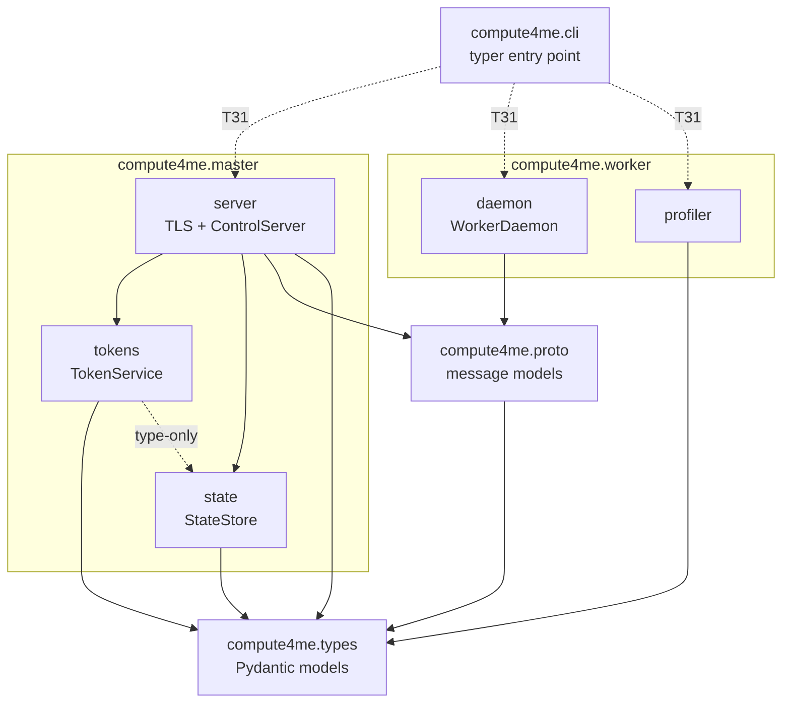
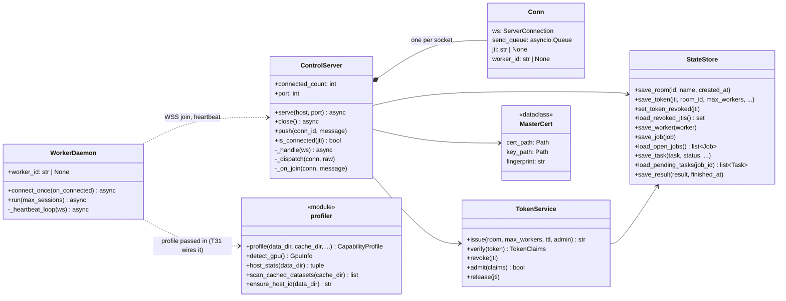
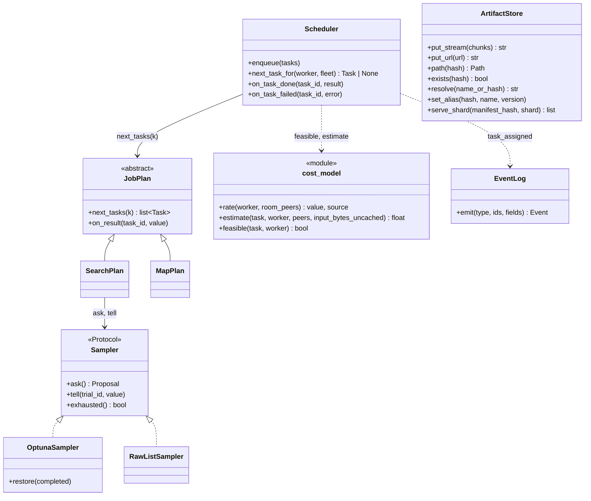
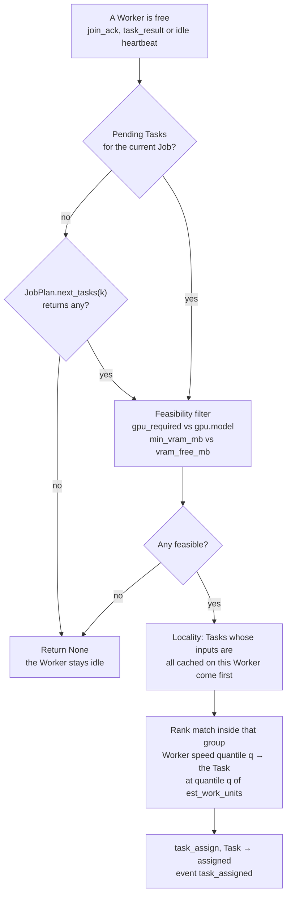
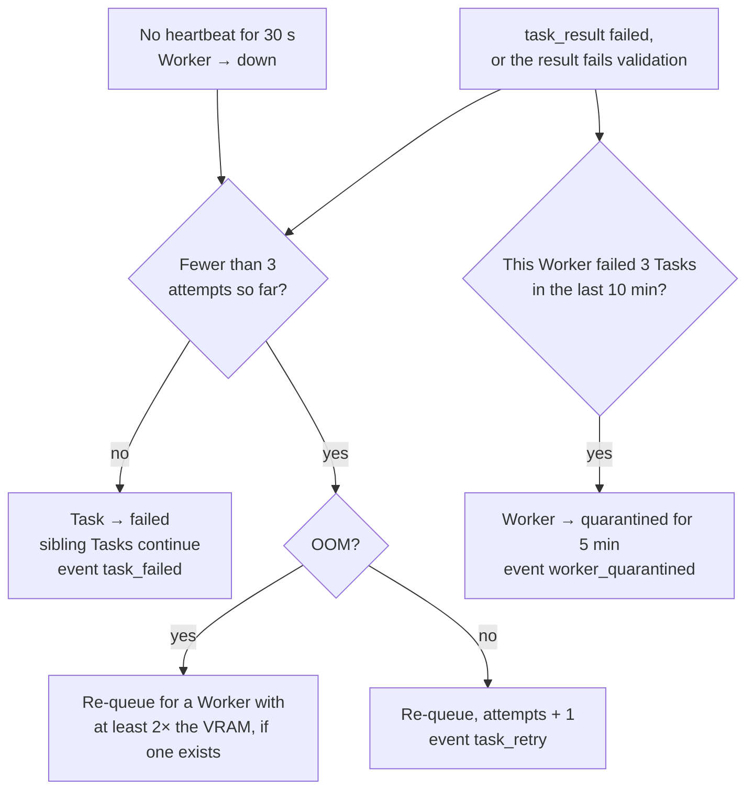
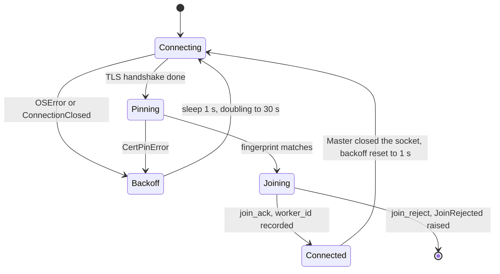
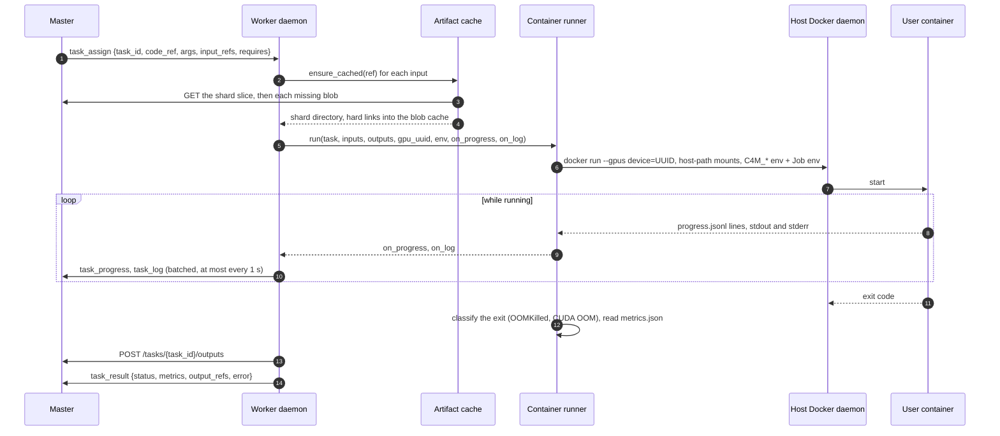

# Module Specifications

Interface signatures for every module in the system. Each module is designed to be **pure or easily faked** so it can be unit-tested in isolation. Signatures shown in indicative Python — implementations can change without invalidating these contracts.

## Package map

*As built (T09).* Solid arrows are imports that exist today; dotted ones arrive with the named task. Modules not shown (`client`, `sdk`, `errors`, and the Master and Worker stubs) import nothing yet.



Import rules ([ADR-0017](../adr/0017-python-toolchain.md); import-linter enforces them from [T28](../tasks/T28-dev-tooling.md)):

| Package | May import from `compute4me` | Never imports |
|---|---|---|
| `types`, `errors` | nothing | everything |
| `proto` | `types` | everything else |
| `master` | `types`, `proto`, `errors`, its own modules | `worker`, `client`, `sdk` |
| `worker` | `types`, `proto`, `errors`, its own modules | `master`, `client`, `sdk` |
| `client` | `types`, `proto`, `errors` | `master`, `worker` |
| `sdk` | nothing (it runs inside user containers) | everything |
| `cli` | anything | (it is the top) |

ML frameworks (torch etc.) are never imported by any of them ([ADR-0016](../adr/0016-benchmark-runs-as-a-container.md)).

## Classes as built

*As built (T09).* The control plane that exists today. `InvalidToken`, `CertPinError` and `JoinRejected` are the exceptions on these paths.



`Conn` is `_Conn` in the code. `profile()` also calls `run_micro_benchmark`, which T30 replaces with the bench container.

## Interfaces planned for P2

*Planned (T11–T17).* The signatures are each card's **recommendation**; they change if the card's Decide-first answer differs, and this diagram changes with them.



| Class | Card |
|---|---|
| `Sampler`, `OptunaSampler`, `RawListSampler` | [T13](../tasks/T13-samplers.md) |
| `JobPlan`, `SearchPlan`, `MapPlan` | [T14](../tasks/T14-decomposer.md) |
| `cost_model` | [T15](../tasks/T15-cost-model.md) |
| `Scheduler` | [T16](../tasks/T16-scheduler.md) |
| `ArtifactStore` | [T11](../tasks/T11-artifact-store.md), [T12](../tasks/T12-shards-and-cache.md) |
| `EventLog` | [T29](../tasks/T29-logging-events.md) |

Worker side: `worker/docker.py` (T30: `run`, `pull`, `image_present` over the `docker` CLI), `cache.ensure_cached(ref) -> Path` (T12) and `runner.run(task, …) -> TaskResult` (T17). Their interaction is the [Task execution](#task-execution-on-a-worker) sequence below.

## Master-side modules

### Token service — `master/tokens.py`

```python
def issue(room: str, max_workers: int | None, ttl: timedelta) -> str
    # Returns signed token string (JWT-style). Persists metadata via state store.

def verify(token: str) -> TokenClaims
    # Raises on bad signature / expired / revoked.

def revoke(jti: str) -> None
    # Marks the token's jti as revoked; future verify() calls raise.

def admit(claims: TokenClaims) -> bool
    # Checks live per-token Worker count < max_workers. If so, increments and returns True.
    # Refuses (returns False) when the cap is reached.

def release(jti: str) -> None
    # Decrements the live count when a Worker disconnects.
```

Pure given an in-memory revocation set + per-token counters. Unit-testable with a fixed signing key. See [ADR-0002](../adr/0002-closed-membership-rooms.md), [ADR-0011](../adr/0011-tls-fingerprint-in-token.md).

Realized as a `TokenService` holding the state store plus an injected **signing key** and **Master cert fingerprint** (the cert itself is generated in T06; injecting both keeps the service pure). Tokens are signed HS256 with the standard `exp`/`jti` registered claims so the library enforces expiry and revocation keys off `jti`; `verify` raises `InvalidToken` on bad signature, expiry, or a revoked `jti`. Token metadata is durable, so the revocation set is rebuilt from the store on construction (revocations survive restart); the per-`jti` live-Worker counts are in-memory (every Worker re-joins after a restart). `issue` ensures the Room row exists before persisting the token (the `tokens.room_id` FK; the Master also auto-creates the Room on `serve --room` — wire-protocol.md §4.10), with `id == name` in v0.1's single-operator model.

### Cost model — `master/cost_model.py`

```python
def estimate(task: Task, worker: CapabilityProfile) -> float
    # Estimated runtime in seconds = work_units / rate(worker).
    # Pure function. Coarse (within ~2×) by design — enough to beat round-robin.

def feasible(task: Task, worker: CapabilityProfile) -> bool
    # VRAM + GPU-required filter. Returns False if the Task structurally cannot run on this Worker.
```

Calibrated to within ~2× in v0.1 — sharper estimates are a v0.2 thread (per-architecture profiling, regression on config features). See [ADR-0008](../adr/0008-smart-pull-scheduling.md), [ROADMAP v0.2](../roadmap.md#v02--scheduler-maturity--concurrency).

### Scheduler — `master/scheduler.py`

```python
def next_task_for(worker_id: str) -> Task | None
    # On a Worker pull: return the best-fit eligible Task from the pending queue.
    # Selection: feasibility filter → cached-input locality preference → fast-Worker-gets-biggest.
    # Returns None if no eligible Task is pending.

def on_task_done(task_id: str, result: TaskResult) -> None
    # Update queue/state; advance Job completion.

def on_task_failed(task_id: str, error: TaskError) -> None
    # Hand off to the failure controller; may re-enqueue (with attempts+1).

def enqueue(tasks: Iterable[Task]) -> None
    # Decomposer feeds new Tasks here when a Job starts.
```

Decision logic is **pure given the pending queue + Capability Profiles** → fully testable without a network. v0.1 runs one Job at a time per Room (FIFO); multi-Job concurrency is v0.2. See [ADR-0008](../adr/0008-smart-pull-scheduling.md).

*Planned (T15, T16), with the cards' recommended rules:*



### Job decomposer — `master/decomposer.py`

```python
def decompose(job: JobSpec) -> Iterator[Task]
    # SearchJobSpec → N config-Tasks (via Sampler).
    # MapJobSpec → shard-Tasks (whole | index-range | file-list).
    # Each emitted Task carries its `requires` (min_vram, est_work_units).
```

Pure given a fixed sampler seed (determinism is required for the eval and for reproducibility).

### Sampler interface — `master/samplers/`

```python
class Sampler(Protocol):
    def ask(self) -> dict
        # Next config to try.
    def tell(self, config: dict, value: float) -> None
        # Report a completed trial's metric back to the sampler.

class OptunaSampler(Sampler): ...
    # TPE / Bayesian via Optuna under the hood.

class RawListSampler(Sampler): ...
    # Iterate a user-provided list[dict] of configs in order. For simple grids.
```

Pluggable interface — adding Hyperopt, scikit-optimize, or DEAP is additive in v0.3+. See [ADR-0010](../adr/0010-wrap-optuna.md).

### Artifact store (Master side) — `master/artifacts.py`

```python
def put(data: bytes | str) -> str
    # Bytes or URL → sha256 hash. Stores content-addressed on disk.
    # Idempotent: identical bytes always return the same hash.

def get(hash: str) -> bytes
    # Retrieve by hash.

def serve_shard(hash: str, shard: ShardDescriptor) -> bytes
    # Range / file-list slice over the artifact. Used by Map Workers
    # to fetch only their assigned shard.
```

Master is the **origin** for all Artifacts in v0.1. Worker-to-Worker artifact transfer is deferred to v0.5 (P2P swarm). See [ADR-0012](../adr/0012-content-addressed-artifacts.md), [ROADMAP v0.5](../roadmap.md#v05--wan).

### Master transport — `master/server.py`

```python
# TLS (T06)
def ensure_cert(data_dir) -> MasterCert
    # Load the Master's self-signed cert from data_dir, generating (key + cert) on first
    # run. Idempotent — reuses the existing cert so the fingerprint is stable across
    # restarts and already-issued tokens stay valid.

def fingerprint_of(cert_path) -> str   # sha256 hex of the DER cert — the value pinned in tokens
def server_ssl_context(cert) -> ssl.SSLContext   # TLS server context presenting the cert

# WS control server (T07)
class ControlServer:
    def __init__(self, tokens: TokenService, cert: MasterCert, store: StateStore)
    async def serve(host, port)          # listen for WSS connections (one per Worker)
    async def close()                    # stop the listener, drop connections
    def push(conn_id, message)           # enqueue a MasterMessage to a Worker (per-Worker send queue)
    connected_count: int                 # currently-open connections
    def is_connected(jti) -> bool        # is an admitted connection for this jti open?
```

Self-signed cert (no CA, no domain — ADR-0011): subject == issuer, 2048-bit RSA, 10y validity (rotation is an ops action, [operations.md](./operations.md), not an expiry concern). The `MasterCert.fingerprint` feeds the [token service](#token-service--mastertokenspy)'s `cert_fp`.

`ControlServer` accepts one persistent WSS connection per Worker over that cert, parses inbound [`WorkerMessage`](./wire-protocol.md#worker--master)s, and pushes [`MasterMessage`](./wire-protocol.md#master--worker)s through a per-Worker `asyncio.Queue`. On `join` (T08) it `verify`s the token, `admit`s a slot, assigns a `worker_id`, persists the Worker (`status='idle'`) via the state store, and replies `join_ack`; a bad/expired/revoked token or an exhausted `max_workers` yields a `join_reject` carrying a reason. The reserved slot is `release`d when the socket closes. Heartbeat-timeout liveness (mark `down` after 30s) is the [failure controller](#failure-controller--masterfailurepy)'s job (T18).

### Master state store — `master/state.py`

```python
def save_job(job) -> None
def save_task(task) -> None
def save_worker(worker) -> None
def save_result(result) -> None
    # All persistence operations. Idempotent / upsert by primary key.

def load_open_jobs() -> list[Job]
    # Used on restart to resume scheduling.

def load_pending_tasks(job_id: str) -> list[Task]
    # Used on restart to refill the Scheduler's queue.
```

SQLite-backed. See [data-model.md](./data-model.md) for the schema.

### Failure controller — `master/failure.py`

```python
def on_heartbeat(worker_id: str, task_id: str | None, throughput_sample: float | None) -> None
    # Updates last_heartbeat_at; optionally records a throughput sample (for monitoring EMA).

def tick(now: datetime) -> list[Action]
    # Periodically called. Returns Actions:
    #   - mark Worker `down` (no heartbeat in 30s) and re-queue its Task
    #   - move Worker into `quarantined` (≥3 failures in 10 min)
    #   - return Worker to `idle` after 5 min quarantine

def classify_failure(task_id: str, error: TaskError) -> Retry | OomPromote | PermanentFail
    # Retry up to 3 attempts; OOM-promote sends the retry to a Worker with ≥2× the original VRAM.

def validate_result(task: Task, result: TaskResult) -> bool
    # Search: metric must be a finite float.
    # Map: declared output Artifact must exist and match the declared schema.
    # Invalid results count as a Task failure.
```

No adversarial defense — see [ADR-0002](../adr/0002-closed-membership-rooms.md). Byzantine-robust validation is a deferred research thread.

*Planned (T18, T19):*



## Worker-side modules

### Capability profiler — `worker/profiler.py`

```python
def profile(*, data_dir, cache_dir, gpu_probe=detect_gpu, stats_probe=host_stats,
            dataset_scan=scan_cached_datasets, benchmark=None) -> CapabilityProfile
    # Build a full CapabilityProfile: GPU/CPU/RAM/disk facts + cached datasets + bench.
    # Probes are injectable (fakes in tests). bandwidth/RTT are left 0.0 — Master-probed (T10).

def detect_gpu() -> GpuInfo          # nvidia-smi, or model='cpu' on any failure
def host_stats(data_dir) -> tuple[int, int, int]   # (cpu_cores, ram_mb, disk_free_mb)
def scan_cached_datasets(cache_dir) -> list[tuple[str, str]]   # (dataset_id, version_hash)
def ensure_host_id(data_dir) -> str  # persisted UUID, stable across restarts
def run_micro_benchmark(seconds: float = 30) -> float
    # Fixed ResNet18 fwd/bwd loop, samples/sec. The yardstick across all Workers.
```

Testable against fake hardware probes (inject `nvidia-smi` / `psutil` shims via the `*_probe` args). `host_id` is persisted in the container volume so it's stable across restarts.

`run_micro_benchmark` is the **only** part that needs PyTorch, and it imports torch lazily — the Worker runs the *user's* container for real training (ADR-0006), so torch is not a Worker runtime dependency. It is the optional `bench` extra (kept out of the default install and both images, which stay lean); a Worker host installs the CUDA-matched build once via [`scripts/setup-worker.sh`](../../scripts/setup-worker.sh). Absent torch, the benchmark raises `BenchmarkUnavailable` with install guidance. The benchmark is GPU/torch-touching → exercised manually, skipped in CI.

> **Known broken, being replaced (2026-11-10).** In the shipped image there is no torch, and `profile()` calls the benchmark directly, so `profile()` raises and the Worker can't join. Host-installed torch is invisible to the Worker container. [ADR-0016](../adr/0016-benchmark-runs-as-a-container.md) replaces this with a benchmark container run through the Docker socket, and makes `throughput_ref` optional; T30 implements it and rewrites this section.

### Container runner — `worker/runner.py`

```python
def run(task: Task, input_dir: Path, output_dir: Path) -> TaskResult
    # docker run user-image with:
    #   C4M_CONFIG       - path to args JSON
    #   C4M_INPUT_DIR    - mounted input Artifacts
    #   C4M_OUTPUT_DIR   - writable dir for metrics.json + result Artifacts
    #   C4M_TASK_ID      - opaque Task id
    # Exit 0 = success; reads output_dir/metrics.json + result Artifacts on success.
    # Tails output_dir/progress.jsonl during execution for live metrics.
```

The user's image stays **vanilla** — no `import compute4me` required. See [ADR-0006](../adr/0006-black-box-container-contract.md) and [wire-protocol.md §1](./wire-protocol.md#1-container-contract-masterworker--user-image).

### Artifact cache — `worker/cache.py`

```python
def ensure_cached(hash: str, shard: ShardDescriptor | None) -> Path
    # Fetch+verify (hash check); skip if already present.
    # Returns the local Path the user container will mount.
```

Worker-side cache is content-addressed (same hash → same local path) — repeat Jobs on the same data do zero transfer. `datasets_cached` in the Capability Profile reflects this cache.

### Worker daemon — `worker/daemon.py`

The top-level loop, not a module with discrete signatures. Responsibilities:

- Open outbound WSS connection to Master; pin Master cert fingerprint from the Invite Token. The cert is self-signed so chain/hostname verification is off (`pinning_ssl_context`); after the handshake, `verify_fingerprint(peer_cert_der, pinned)` compares the presented cert's sha256 to the token's value and raises `CertPinError` on mismatch (ADR-0011).
- Build profile + send `join`. Handle `join_ack` / `join_reject`.
- Heartbeat every 10s.
- Receive `task_assign` → call `cache.ensure_cached(...)` for inputs → call `runner.run(...)` → send `task_result`.
- Receive `task_cancel` → SIGTERM (30s grace) → SIGKILL the user container.
- Reconnect with backoff on transient drops.

*As built (T08):* the connection state machine of `WorkerDaemon.run`.



A `CertPinError` is currently retried like a network error, although a pinned fingerprint never starts matching; [T31](../tasks/T31-runnable-cli.md) settles whether it becomes terminal.

### Task execution on a Worker

*Planned (T12, T17), with the cards' recommendations:*



Realized (T08) as `WorkerDaemon(master_url, token, cert_fp, profile)`. `connect_once()` runs one session: open the WSS connection (`pinning_ssl_context`), pin the Master cert (`verify_fingerprint` on the presented cert), send `join` with the Capability Profile, await `join_ack` (records `worker_id`) or `join_reject` (raises `JoinRejected` with the reason), then heartbeat on an interval until the socket drops. `run(max_sessions=None)` is the reconnect loop: clean sessions reset the backoff, transient drops back off exponentially (1s→30s), and a `join_reject` is terminal (propagates — retrying won't fix the token). The `profile` is injected so the daemon is testable without hardware probes; T09's profiler supplies the real `profile()`.

## Shared / client-side modules

### Python submission API — `client/api.py`

```python
class Client:
    def __init__(self, master: str, token: str): ...      # URL separate from the token (ADR-0015)
    @classmethod
    def from_env(cls) -> Client                           # C4M_MASTER, C4M_TOKEN
    @classmethod
    def from_token(cls, token: str, master: str) -> Client
    def submit_search(self, image, metric, n_trials, ...) -> JobHandle
    def submit_map(self, image, dataset, shard, ...) -> JobHandle
    def get_job(self, job_id: str) -> JobHandle
    def list_jobs(self, status=...) -> list[JobHandle]
    def fleet(self) -> FleetSnapshot

class JobHandle:
    id: str
    def status(self) -> JobStatus
    def wait(self, timeout=None) -> JobStatus
    def results(self) -> list[TrialResult] | list[MapOutput]
    def fetch(self, out: Path) -> None
    def cancel(self) -> None
    def progress(self) -> Iterator[...]
```

The researcher's primary submission surface. See [wire-protocol.md §5](./wire-protocol.md#5-python-submission-api-researcher--primary-submit-surface).

### SDK sugar — `sdk/__init__.py` (importable inside user containers)

```python
def config() -> dict        # reads C4M_CONFIG
def input_dir() -> Path     # reads C4M_INPUT_DIR
def output_dir() -> Path    # reads C4M_OUTPUT_DIR
def report(metrics: dict) -> None   # writes metrics.json
def progress(**fields) -> None      # appends a JSON line to progress.jsonl
```

Pure sugar over the file contract. **Optional** — user containers can use plain `os.environ` and file I/O instead.

## Module testability matrix

| Module | Pure? | Test approach |
|---|---|---|
| Cost model | ✅ Yes | Unit: assert ratios/ordering for synthetic Tasks + Profiles |
| Scheduler | ✅ Yes (no I/O) | Unit: fixed pending queue + Profiles → assert best-fit decisions |
| Job decomposer | ✅ Yes (seeded sampler) | Unit: seeded Search → assert configs; Map → assert shard boundaries |
| Token service | ✅ Yes (fixed key) | Unit: issue→verify, expiry, revocation, max_workers cap |
| Failure controller | ✅ Yes (injected clock) | Unit: simulated timeouts/failures → assert state transitions |
| Artifact store | ✅ Yes (tmp dir) | Unit: same bytes → same hash; cache-hit skip; mismatch handling |
| Capability profiler | ⚠️ Hardware-touching | Unit with fake probes; manual on real GPU host |
| Container runner | ⚠️ Docker-touching | Unit with FakeRunner; manual with real Docker |
| Worker daemon | ⚠️ Network-touching | Integration with FakeWorker driving the wire protocol |
| Python submission API | ⚠️ Network-touching | Integration against a real Master + fake Workers |

The first six are **fast, deterministic, GPU-free, Docker-free**. They form the bulk of the CI test suite. The last four require fakes (in `tests/fakes/`) or manual verification.
