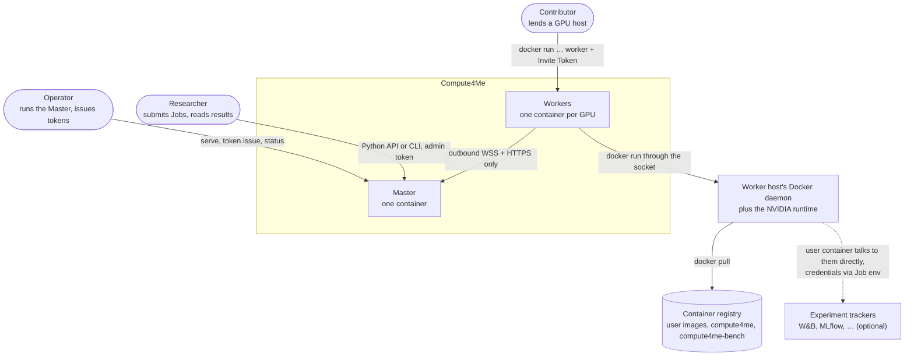
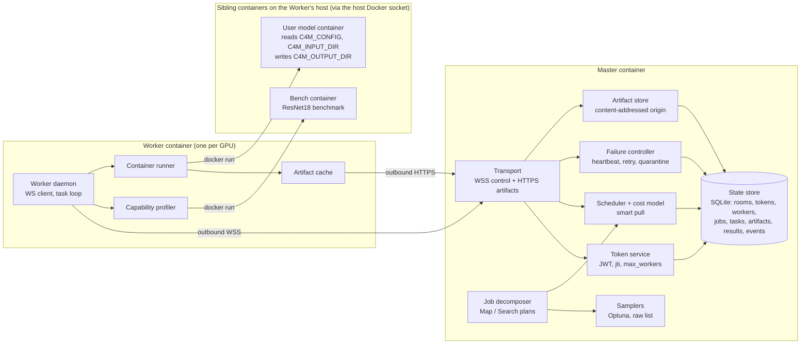
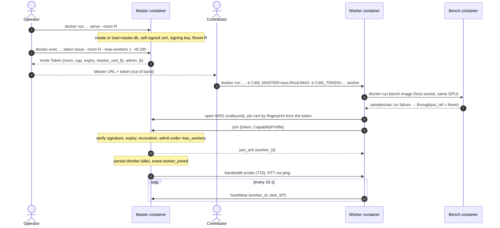
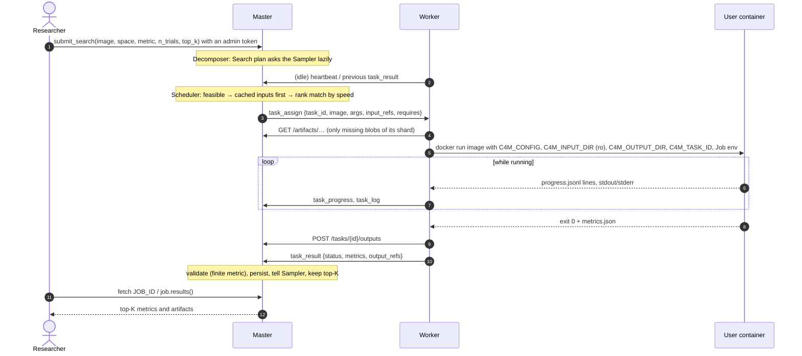
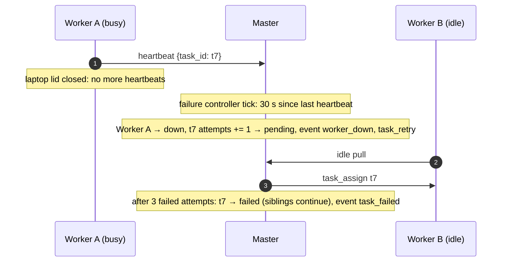
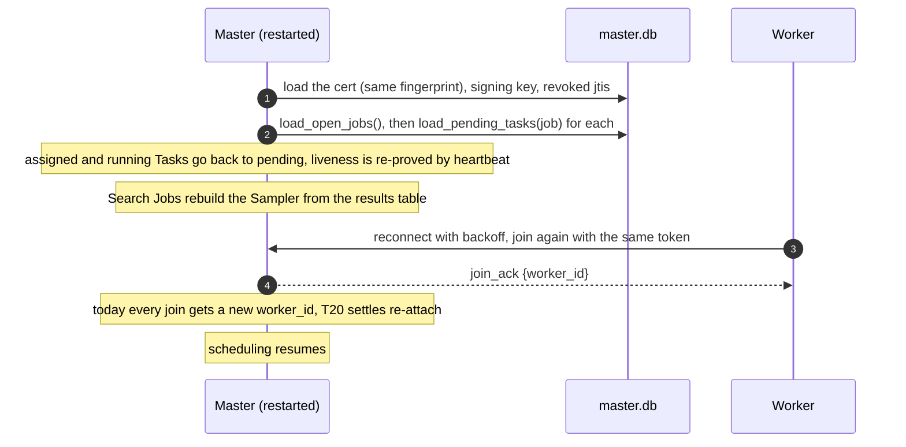
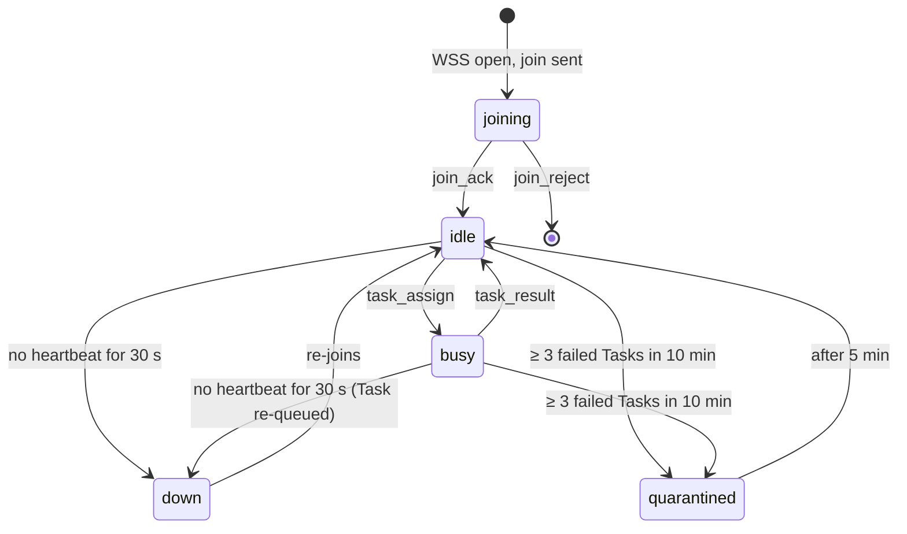
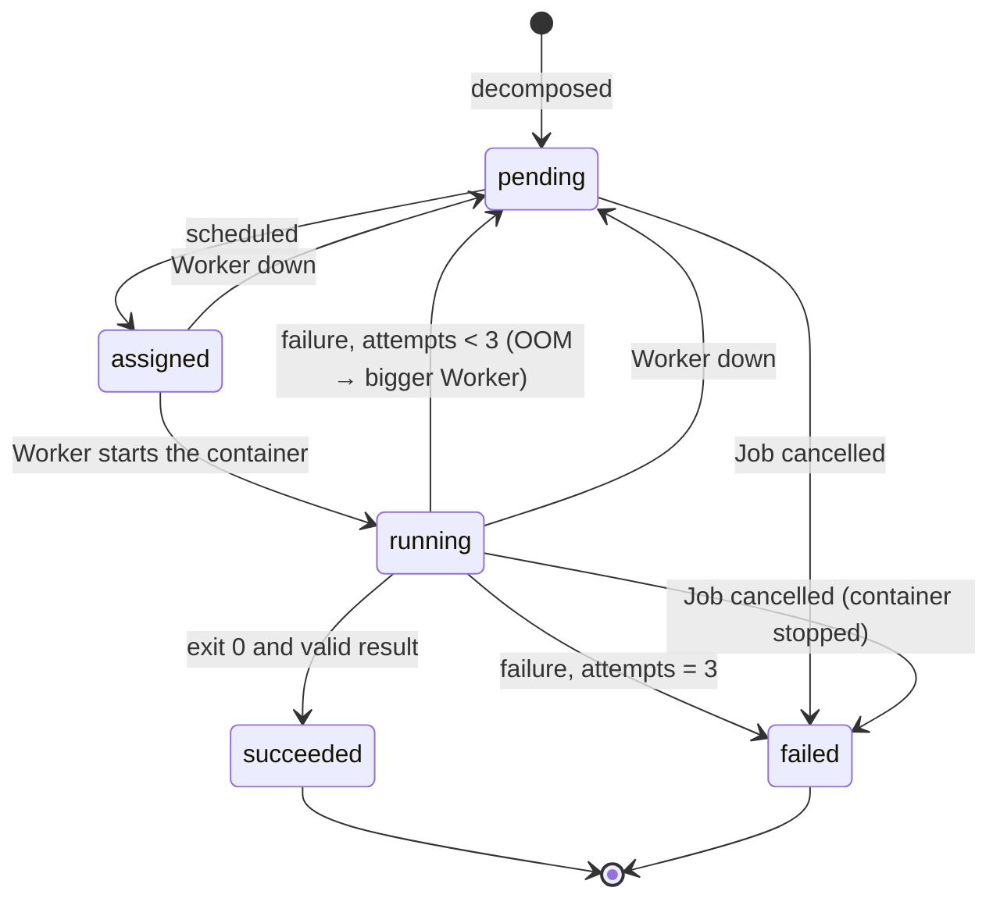
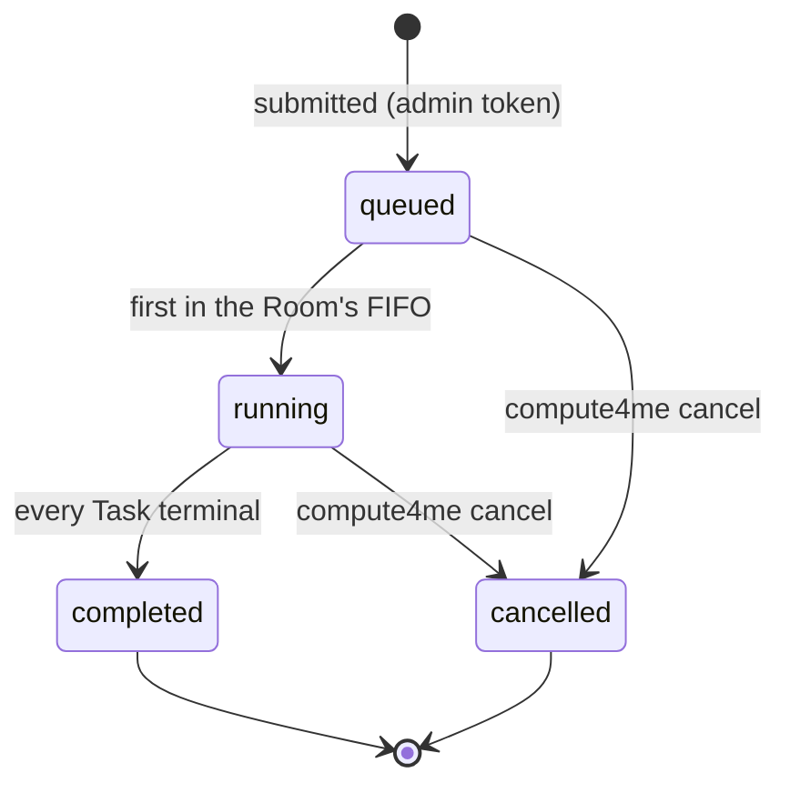

# System overview

How Compute4Me is structured, in pictures. Data, module and protocol detail live in the sibling files in this folder; terms are defined in [context.md](../context.md).

## One-paragraph summary

A **Master** process opens a **Room** and issues **Invite Tokens**. A contributor runs one Docker container with the Master's URL and a token, and becomes a **Worker**, connecting *outbound only*: no inbound ports, SSH or firewall changes. Each Worker advertises a **Capability Profile** (GPU, VRAM, a measured throughput benchmark, cached datasets, bandwidth/RTT). A researcher submits a **Job**: a **Map** (one container image over data shards) or a **Search** (one container image over a configuration space). The Master's **Decomposer** expands the Job into **Tasks**; the **Scheduler** hands each free Worker its best-fit eligible Task (VRAM-feasible, cached inputs first, faster Worker gets the bigger Task). Workers run user images under the **Container Contract** (env-vars-in, files-out, no `import compute4me`), report results through the Master, and wait for more. Dead Workers are detected within ~30 s and their Tasks retried; flaky Workers are quarantined; Master state is persisted in SQLite for restart recovery. Every state change is recorded as an **Event**.

## System context

*Concept; stable across versions.* Who uses Compute4Me and what it touches outside itself.

Compute4Me never talks to an experiment tracker itself; it only forwards the Job's `env` ([wire-protocol.md §1](./wire-protocol.md#job-supplied-environment-variables-env)).

## Components

| Component | Side | Responsibility | Interface |
|---|---|---|---|
| Transport | Master | One persistent WSS connection per Worker (control) and HTTP routes (artifacts); the seam where a Sub-Master or P2P transport could slot in later | [modules.md](./modules.md#master-transport--masterserverpy), [ADR-0007](../adr/0007-websocket-http-transport.md) |
| Token service | Master | Issue, verify and revoke Invite Tokens; live per-token Worker counts | [modules.md](./modules.md#token-service--mastertokenspy) |
| Job decomposer + Samplers | Master | Map Job → shard-Tasks; Search Job → config-Tasks, asked lazily from the Sampler | [modules.md](./modules.md#job-decomposer--masterdecomposerpy), [ADR-0010](../adr/0010-wrap-optuna.md) |
| Scheduler + cost model | Master | On a Worker pull, return the best-fit eligible Task | [modules.md](./modules.md#scheduler--masterschedulerpy), [ADR-0008](../adr/0008-smart-pull-scheduling.md) |
| Failure controller | Master | Heartbeat timeouts, retries, OOM promotion, quarantine, result validation | [modules.md](./modules.md#failure-controller--masterfailurepy) |
| Artifact store | Master | Content-addressed blobs; shard serving | [modules.md](./modules.md#artifact-store-master-side--masterartifactspy), [ADR-0012](../adr/0012-content-addressed-artifacts.md) |
| State store | Master | Durable SQLite state; restart recovery; the event log | [data-model.md](./data-model.md) |
| Worker daemon | Worker | Connect, pin the cert, join, heartbeat, run assigned Tasks, reconnect | [modules.md](./modules.md#worker-daemon--workerdaemonpy) |
| Capability profiler | Worker | Hardware facts, cached datasets, the benchmark (as a sibling container) | [modules.md](./modules.md#capability-profiler--workerprofilerpy), [ADR-0016](../adr/0016-benchmark-runs-as-a-container.md) |
| Container runner | Worker | Run the user image under the Container Contract via the host Docker socket | [modules.md](./modules.md#container-runner--workerrunnerpy), [ADR-0006](../adr/0006-black-box-container-contract.md) |
| Artifact cache | Worker | Fetch, verify and cache inputs; build shard directories | [modules.md](./modules.md#artifact-cache--workercachepy) |

## End-to-end flow

### Join

### Submit, schedule, run, collect

### A Worker dies mid-Task

### The Master restarts

*Planned (T20); the store's `load_*` calls exist since T03.*

## Lifecycle states

### Worker

### Task

### Job

The `tasks.status` column stores `pending | assigned | running | succeeded | failed` ([data-model.md](./data-model.md)); a retryable failure returns the Task to `pending` with `attempts + 1`.

## Network model

- **Workers connect outbound only to the Master** (control channel and artifacts). No inbound ports and no Worker-to-Worker links ([ADR-0003](../adr/0003-master-on-data-plane.md)).
- **The Master must be reachable from every Worker:** one lab machine on a routable interface, or a small VPS.
- **The Master URL and the token travel separately** ([ADR-0015](../adr/0015-master-url-separate-from-token.md)); the token's cert fingerprint authenticates whichever host answers ([ADR-0011](../adr/0011-tls-fingerprint-in-token.md)).
- **One Worker = one container.** A host with two GPUs runs two Worker containers to contribute both.
- **The Worker drives the host's Docker daemon** through the mounted socket to run bench and user containers. They are siblings on the host, which matters for GPU selection and volume paths ([deployment.md](./deployment.md)).

## Stack

- **Python 3.13 throughout** (Master, Worker daemon, client), pinned with uv ([ADR-0017](../adr/0017-python-toolchain.md)); the Master relays and schedules rather than computing.
- **SQLite** for Master state.
- **WebSocket + HTTP** over TLS, not gRPC ([ADR-0007](../adr/0007-websocket-http-transport.md)); TLS by fingerprint pinning, no CA or domain ([ADR-0011](../adr/0011-tls-fingerprint-in-token.md)).
- **One Docker image** for Master and Worker; no ML framework inside it ([ADR-0016](../adr/0016-benchmark-runs-as-a-container.md)).
- **stdlib logging + a persisted event table** ([ADR-0018](../adr/0018-logging-and-events.md)).
- User images come from an accessible registry (Docker Hub, GHCR).

## What this architecture is *not* designed for

Deliberate exclusions, each recorded in an ADR:

- **Open/public Rooms** without tokens ([ADR-0002](../adr/0002-closed-membership-rooms.md)).
- **Byzantine-robust aggregation** for untrusted Workers; trust is established out of band.
- **Models that don't fit one Worker's GPU** in v0.1–v0.5 ([ADR-0004](../adr/0004-big-models-out-of-scope.md)).
- **Hierarchical multi-tier aggregation** ([ADR-0001](../adr/0001-flat-master-not-hierarchical.md)).
- **Master HA / multi-process**: single-process Master + SQLite is the design at the target scale.

## Where to go from here

| Want | Read |
|---|---|
| The data layer | [data-model.md](./data-model.md) |
| Module interfaces | [modules.md](./modules.md) |
| Wire protocol, CLI, Python API | [wire-protocol.md](./wire-protocol.md) |
| Why a choice was made | [../adr/](../adr/README.md) |
| What v0.1 must do | [../prd.md](../prd.md) |
| What to build next | [../plan.md](../plan.md) |
