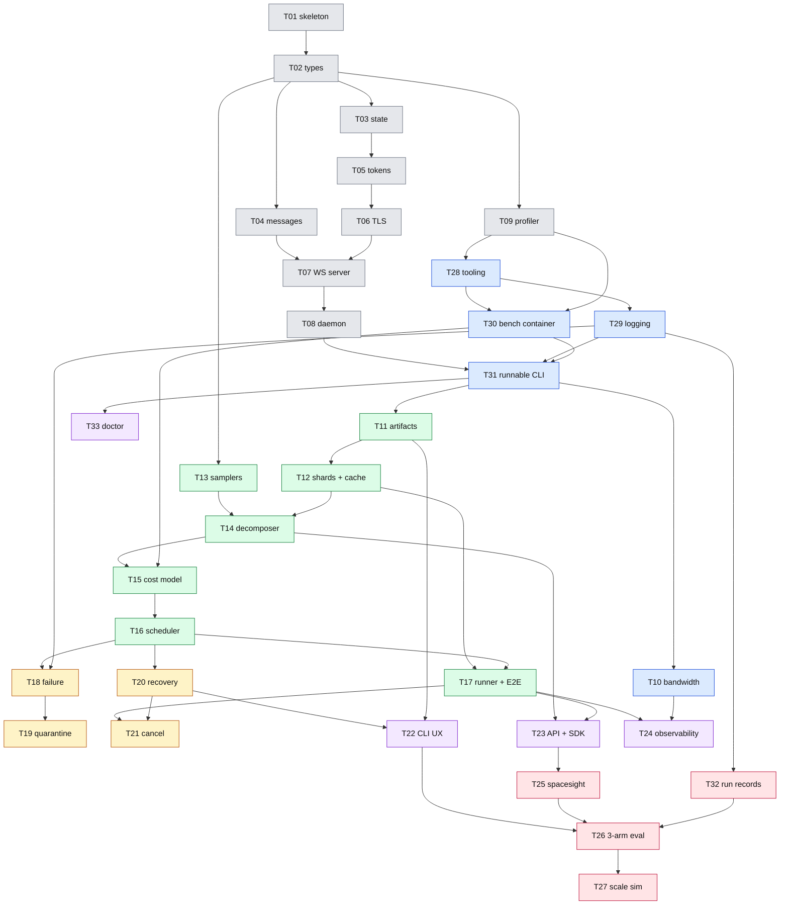

# Implementation plan — v0.1

**Source of truth for *what*:** [prd.md](./prd.md) · **This doc:** *how and in what order* · **Task cards:** [tasks/](./tasks/README.md)

## How this plan works

- **Task by task, not week by week.** Each task is one self-contained unit of about 3–8 hours, delivered as one PR. v0.1 is a solo build with no fixed dates; phases give the order, not a calendar.
- **Rolling-wave detail.** Every task is listed here. **Full cards** exist for the current and next phase (P1, P2). Tasks in P3–P5 are **stubs** at the end of this file; each gets a full card in a short **detailing session** before its phase starts, using what the earlier phases taught.
- **Every full card** has the background needed to start without searching, the decisions to settle before coding (each with a recommendation), steps, tests, a Docker verification step, a "Done when" list and an "If this fails" section.
- **Task IDs are stable.** T01–T27 keep their original numbers; tasks added on 2026-11-10 are T28+. **Order comes from the phases and the dependency graph below, not from the numbers.**
- **Changing the plan:** edit this file and the card in a PR. If a decision changes, update the ADR with a History line ([adr/README.md](./adr/README.md)).

## Phases

| Phase | Goal | Tasks (in order) | Tracer bullet (the phase is done when this works) |
|---|---|---|---|
| **P0 — Scaffolding** ✅ | Repo, types, state store, wire models | T01–T04 | `uv sync`, `docker build`, `compute4me --help` |
| **P1 — Control-plane bootstrap** | A Worker *container* joins a Master *container* | T05–T09 ✅, then **T28 → T29 → T30 → T31 → T10** | `docker compose up` with one Master and one Worker: the Worker joins, the Master stores its Capability Profile (with `throughput_ref` and bandwidth/RTT). Runs in CI. |
| **P2 — Job execution core** | One Job runs end to end | T11, T12, T13, T14, T15, T16, T17 | A tiny Search Job (4 trials of `examples/toy_quadratic`) completes on 2 fake Workers in pytest **and** on 2 real Worker containers locally |
| **P3 — Reliability** | Survives drops, failures and restarts | T18, T19, T20, T21 | Kill a Worker and then the Master mid-Job; the Job still completes |
| **P4 — Interfaces & observability** | The full operator and researcher UX | T22, T23, T24, T33 | PRD §13 criteria 1–3 and 8, run from a clean machine with the full CLI |
| **P5 — Eval & research harness** | The scheduler paper's numbers | T32, T25, T26, T27 | One command produces the 3-arm makespan + operator-effort table from registered runs |

Why P1 changed (2026-11-10): `serve`, `worker` and `token issue` were scheduled for T22 (P4), so until P4 nothing could be run from the image, and the Docker-first verification rule ([ADR-0020](./adr/0020-docker-is-the-verification-surface.md)) could not be followed. The Worker image also could not join at all, because the benchmark needed torch and the image has none ([ADR-0016](./adr/0016-benchmark-runs-as-a-container.md)). T28–T31 fix the tooling, add logging, fix the benchmark and wire the minimal CLI before any more features land.

## Task index

Sizes: **M** ≈ 3–5 h · **L** ≈ 5–8 h · **L+** = a full day or more. Status: ✅ merged · 🃏 full card · 📝 stub (card written at the detailing session).

| ID | Task | Phase | Size | Depends on | Card / PR |
|---|---|---|---|---|---|
| T01 | Repo skeleton + packaging + image | P0 | M | — | ✅ #1 |
| T02 | Core types (`types.py`) | P0 | M | T01 | ✅ #3 |
| T03 | Master state store (`master/state.py`) | P0 | M | T02 | ✅ #4 |
| T04 | Wire message models (`proto/messages.py`) | P0 | M | T02 | ✅ #5 |
| T05 | Token service (`master/tokens.py`) | P1 | M | T02, T03 | ✅ #6 |
| T06 | Self-signed TLS + fingerprint pinning | P1 | M | T05 | ✅ #7 |
| T07 | WebSocket transport server | P1 | M | T04, T06 | ✅ #8 |
| T08 | Worker daemon + join handshake | P1 | L | T07 | ✅ #9 |
| T09 | Capability profiler + micro-benchmark | P1 | M | T02 | ✅ #10 |
| T28 | Dev tooling and CI hardening | P1 | M | T09 | 🃏 [card](./tasks/T28-dev-tooling.md) |
| T29 | Logging and event foundation | P1 | L | T28 | 🃏 [card](./tasks/T29-logging-events.md) |
| T30 | Benchmark as a container | P1 | L | T09, T28 | 🃏 [card](./tasks/T30-benchmark-container.md) |
| T31 | Runnable `serve` / `token issue` / `worker` + compose join smoke | P1 | L | T08, T29, T30 | 🃏 [card](./tasks/T31-runnable-cli.md) |
| T10 | Bandwidth/RTT probe + periodic profile refresh | P1 | M | T31 | 🃏 [card](./tasks/T10-bandwidth-probe.md) |
| T11 | Artifact store, Master origin (HTTP) | P2 | L | T03, T31 | 🃏 [card](./tasks/T11-artifact-store.md) |
| T12 | Shard serving + Worker cache | P2 | M | T11 | 🃏 [card](./tasks/T12-shards-and-cache.md) |
| T13 | Sampler interface + Optuna + raw list | P2 | M | T02 | 🃏 [card](./tasks/T13-samplers.md) |
| T14 | Job decomposer | P2 | M | T12, T13 | 🃏 [card](./tasks/T14-decomposer.md) |
| T15 | Cost model | P2 | M | T14, T30 (T10 for bandwidth) | 🃏 [card](./tasks/T15-cost-model.md) |
| T16 | Smart-pull scheduler | P2 | L | T14, T15 | 🃏 [card](./tasks/T16-scheduler.md) |
| T17 | Container runner + dispatch + E2E | P2 | L+ | T08, T12, T16, T30 | 🃏 [card](./tasks/T17-runner-and-e2e.md) |
| T18 | Heartbeat + failure controller | P3 | L | T07, T16, T29 | 📝 [stub](#t18-heartbeat--failure-controller-p3-l) |
| T19 | Quarantine + result validation | P3 | M | T18 | 📝 [stub](#t19-quarantine--result-validation-p3-m) |
| T20 | Master persistence + restart recovery | P3 | M | T03, T16 | 📝 [stub](#t20-master-persistence--restart-recovery-p3-m) |
| T21 | Job cancellation | P3 | M | T17, T20 | 📝 [stub](#t21-job-cancellation-p3-m) |
| T22 | Operator CLI: full surface and UX | P4 | L | T05, T11, T20, T31 | 📝 [stub](#t22-operator-cli-full-surface-and-ux-p4-l) |
| T23 | Python submission API + SDK | P4 | L | T14, T17 | 📝 [stub](#t23-python-submission-api--sdk-p4-l) |
| T24 | Observability commands + live display | P4 | L | T10, T17, T29 | 📝 [stub](#t24-observability-commands--live-display-p4-l) |
| T33 | Host check (`compute4me doctor`) | P4 | M | T30, T31 | 📝 [stub](#t33-host-check-compute4me-doctor-p4-m) |
| T32 | Experiment run records + results registry | P5 | M | T29 | 📝 [stub](#t32-experiment-run-records--results-registry-p5-m) |
| T25 | `spacesight` workload images | P5 | L+ | T17, T23 | 📝 [stub](#t25-spacesight-workload-images-p5-l) |
| T26 | 3-arm scheduler experiment harness | P5 | L+ | T22, T25, T32 | 📝 [stub](#t26-3-arm-scheduler-experiment-harness-p5-l) |
| T27 | Scale simulation | P5 | L | T16, T26 | 📝 [stub](#t27-scale-simulation-p5-l) |

## Task dependency graph

Arrows point from a task to the tasks that need it. Merged tasks are grey.

Edges that are implied by a longer path (e.g. T08 → T17, which also goes through T31 → T11 → T12 → T17) are drawn only once. The **Depends on** column in the index is the full list.

## Open items

Decisions a later task owns. Each card's **Decide first** section has the options and a recommendation; settle them with the user before coding, then record the answer (ADR or card History).

| Item | Owner | Why it matters |
|---|---|---|
| One port or two for WSS + HTTP. The image exposes only 8443, and the `websockets` server can't host Starlette routes. | T11 | Every firewall rule and every `docker run -p` in the docs |
| What an `index-range` shard indexes. An Artifact is one blob, so a "dataset" needs a file structure (tar, or a manifest of file blobs). | T12 | Map Jobs, the Worker cache layout, `datasets_cached` |
| Where a Task's `requires` (VRAM, work units) come from. `SearchJobSpec`/`MapJobSpec` have no field for them, but the cost model needs them. | T14 | Whether the scheduler has anything to be smart with |
| Docker-outside-of-Docker mounts. The Worker uses the *host's* Docker, so the `-v` paths for user containers must be host paths, not paths inside the Worker container. | T17 | Whether user containers see their inputs at all |
| How `logs task <id> -f` gets container output to the Master (no wire message carries logs today) | T17 (wire), T24 (CLI); direction in [ADR-0018](./adr/0018-logging-and-events.md) | ADR-0013's `logs` command |
| Source of **Real-time Throughput** in v0.1: v0.1 has no training steps, so "EMA over training-step heartbeats" has no input. Likely a `samples_per_sec` field in `progress.jsonl`. | T24 | `status` display; the v0.2 rebalancing signal |

## Detailing sessions

| When | Output |
|---|---|
| Before P3 starts (after T17 merges) | Full cards for T18–T21 |
| Before P4 starts | Full cards for T22–T24, T33 |
| Before P5 starts | Full cards for T32, T25–T27; fleet hardware and schedule for the real-fleet runs |

## Definition of done (every task)

- [ ] Every **Done when** item on the card is ticked in the PR description.
- [ ] `make check` passes locally and every CI job is green, including the image job.
- [ ] The card's **Verify in Docker** step was run and its output is in the PR ([ADR-0020](./adr/0020-docker-is-the-verification-surface.md)). "No image impact" is allowed only when the card says so.
- [ ] Tests carry `task("Txx")` and a kind marker; [tests/INDEX.md](../tests/INDEX.md) is updated.
- [ ] Docs travel with the code: the card's Status row, [CHANGELOG.md](../CHANGELOG.md), the architecture docs and [context.md](./context.md) for anything that changed, and an ADR History line for any decision that moved.
- [ ] A real problem that changed a design or would have produced wrong behaviour gets an entry in [background/challenges-faced.md](./background/challenges-faced.md).
- [ ] Follow-ups are filed as issues (`polish` or `spec-issue`), not left only in the PR text.
- [ ] Squash-merged with a Conventional Commit title containing the task ID.

## GitHub tracking

- **One issue per task**, created from the `Task` issue form, linking its card. The issue tracks who/when/blockers; the card is the spec. (Issue numbers do not match task numbers; PRs already used #1–#10.)
- **Milestones = phases** (`P1 — Control-plane bootstrap` … `P5 — Eval & research harness`).
- **Labels:** `phase:P1`…`phase:P5`, `polish`, `spec-issue`, `bug`, `blocked`, `needs-docker`, `needs-gpu`, `needs-fleet`.
- **Tracking issue "Needs the real fleet":** everything that can only be checked on real hardware (lab GPUs, a NAT'd contributor, the VPS Master), ticked as each is done. The [PRD §13](./prd.md#13-acceptance-criteria-v01-done) criteria not marked *(CI)*, and T25–T27, live there.

---

## Stubs: P3, P4, P5

Each gets a full card at its detailing session. The bullets are enough to see the shape of the work.

### T18: Heartbeat + failure controller (P3, L)

- `master/failure.py` per [modules.md](./architecture/modules.md#failure-controller--masterfailurepy): `on_heartbeat`, `tick(now) -> list[Action]` with an injected clock, `classify_failure`.
- 30 s heartbeat timeout → Worker `down`, its Task re-queued. ≤ 3 attempts. OOM → retry on a Worker with ≥ 2× the VRAM when one exists. Permanent failure never blocks sibling Tasks.
- Emits `worker_down`, `task_retry`, `task_failed` events ([ADR-0018](./adr/0018-logging-and-events.md)).
- **Acceptance:** a simulated timeout re-queues the in-flight Task; a 3×-failing Task ends `failed` while siblings continue; an OOM retry targets a higher-VRAM Worker.

### T19: Quarantine + result validation (P3, M)

- ≥ 3 failures in 10 min → quarantined 5 min → auto-restored. `validate_result`: finite Search metric; declared Map outputs present.
- **Acceptance:** a flaky fake Worker enters and leaves quarantine on schedule; a `NaN` metric is rejected and retried; a missing declared output fails validation.

### T20: Master persistence + restart recovery (P3, M)

- All scheduling state durable; on restart `load_open_jobs()` refills the queue; Workers re-join and re-attach.
- Settle: the SQLite connection mode for two processes (`serve` plus `docker exec … token issue`): WAL, busy timeout.
- Settle: Worker identity on re-join. Today every `join` gets a fresh `uuid4` `worker_id` ([server.py](../src/compute4me/master/server.py) `_on_join`), so a reconnecting Worker looks new and its old row stays `idle`. Options: key re-attach on `(host_id, token jti)`, or have the Worker resend its last `worker_id`. T18 needs the answer too (marking the old row `down`).
- **Acceptance:** kill the Master container mid-Job and restart it → the Job resumes, collected results are kept, no duplicate top-K beyond idempotent re-runs.

### T21: Job cancellation (P3, M)

- `cancel` → `task_cancel` to Workers running that Job; SIGTERM, 30 s grace, SIGKILL; partial Task results discarded; collected results returned.
- **Acceptance:** cancel mid-sweep stops running containers within ~30 s; `fetch` still returns the completed trials.

### T22: Operator CLI: full surface and UX (P4, L)

- T31 shipped minimal `serve`/`worker`/`token issue`. T22 adds the rest of [wire-protocol.md §4](./architecture/wire-protocol.md#4-cli): `token revoke/list`, `jobs`, `cancel` (prompt unless `--yes`), rendering modes (`--ascii`, `--slop`), exit codes ([error-handling.md](./architecture/error-handling.md)), `C4M_*` precedence, `-d`, verbosity flags.
- Settle: how remote commands (`status`, `jobs`, `cancel` from a laptop) reach the Master. They need an authenticated admin endpoint; T11's HTTP app is the natural host.
- **Acceptance:** PRD §13 criteria 1–3 and 8 from a clean machine; `--ascii`/`--slop` render; stdout-not-a-TTY emits JSON-lines.

### T23: Python submission API + SDK (P4, L)

- `Client.from_env/from_token/__init__`, `submit_search/submit_map`, `JobHandle`, `list_jobs/get_job/fleet`; admin tokens required ([ADR-0014](./adr/0014-admin-tokens-for-submission.md)); `env={...}` forwarding; exception hierarchy; context-manager auto-cancel; `c4m` SDK sugar.
- Fix while here: `Client.from_token` must not imply the token carries the Master URL ([ADR-0015](./adr/0015-master-url-separate-from-token.md)).
- **Acceptance:** a Search Job submitted from Python completes and downloads; the sample image runs the same with and without the SDK; a non-admin token raises `AuthError`.

### T24: Observability commands + live display (P4, L)

- `status [--watch]`, `progress JOB_ID`, `logs <target>`, `events`, and the foreground display for `serve`/`worker` ([ADR-0013](./adr/0013-cli-design-and-observability.md)). Built on the event table and logging from T29 and the log shipping from T17.
- **Acceptance:** `status` shows join/leave/quarantine within one heartbeat; `events --type task_failed -f` streams only failures; `logs task t_x -f` streams the container's output.

### T33: Host check, `compute4me doctor` (P4, M)

- One command a contributor runs before joining: Docker socket reachable, `docker run --gpus all` works (NVIDIA Container Toolkit), the bench image is pullable, `C4M_MASTER` reachable, the cert fingerprint matches the token, cache volume free space. Prints ✅/❌ per check with a hint; exit code 1 if a required check fails.
- Adds a command to the ADR-0013 surface (History line there).
- Every real-fleet machine runs it and posts the output on the "Needs the real fleet" issue.

### T32: Experiment run records + results registry (P5, M)

- Implements [ADR-0019](./adr/0019-experiment-run-records.md): every eval run gets an auto-named folder with resolved config, git state (dirty flag), environment, **fleet snapshot** (every Worker's Capability Profile), log and results; `runs/index.csv`; `results/registry.yaml`; a test that rejects dirty runs in the registry.
- **Acceptance:** two runs of a toy experiment produce two folders; a dirty-tree run cannot be registered; figures read only from the registry.

### T25: `spacesight` workload images (P5, L+)

- `train` image (Search) and `infer` image (Map) for the InceptionResNet exoplanet detector honouring the Container Contract; Kepler light curves ingested as an Artifact.
- **Acceptance:** a 32-trial Optuna sweep and a file-list Map inference both complete on the real fleet with sane metrics.

### T26: 3-arm scheduler experiment harness (P5, L+)

- The same HPO workload on the same fleet under Ray default, Ray with manual resource labels, and Compute4Me; report makespan and operator effort (lines of manual config); fleet profiles captured (T32).
- **Acceptance:** one command runs all three arms and emits the table from registered runs; two repeats agree within noise.

### T27: Scale simulation (P5, L)

- Replay the scheduler against synthetic fleets of 10/50/200 Workers with controllable skew and churn; compare against round-robin and a Ray-style baseline.
- **Acceptance:** makespan-vs-skew and makespan-vs-scale curves; smart-pull dominates round-robin as skew grows; deterministic under a fixed seed.
